<p align="center">
  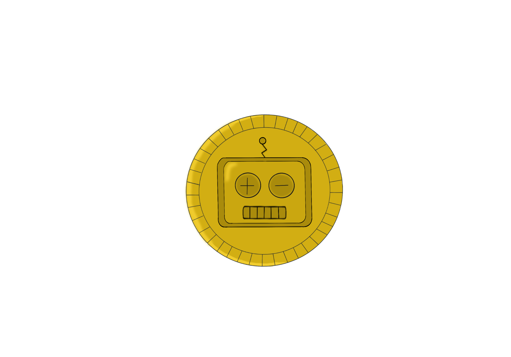
</p>

# Coin Stack

**Juegos en Red · Grado en Diseño y Desarrollo de Videojuegos · URJC · Curso 2026/27**<br>
**Grupo H**

## Descripción de la temática

Coin Stack es un juego recolector competitivo en 2D para dos jugadores en red en el que tendrán que enfrentarse a contrarreloj para recoger el máximo número de monedas en un tablero con obstáculos y trampas. Ambientado en una arena de combate 2D con zonas verdes, los jugadores deben agudizar sus habilidades y astucia para poder superar a su contrincante.

## Equipo de desarrollo

| Nombre y apellidos | Correo URJC | GitHub |
| :--- | :--- | :--- |
| Marina Perona García | m.perona.2024@alumnos.urjc.es | `@marinopepinillo` |
| Carla González Domínguez | c.gonzalezd.2024@alumnos.urjc.es | `@Macarroneh` |
| Irene Mendoza Mederos | i.mendoza.2024@alumnos.urjc.es | `@irenemendo114` |
| José Manuel Gómez Ruiz | jm.gomez.2024@alumnos.urjc.es | `@jmgomezzz` |

**Repositorio:** [https://github.com/jmgomezzz/CoinStack](https://github.com/jmgomezzz/CoinStack)

**Licencia:** [Apache 2.0](LICENSE)

---

## Fase 2: versión jugable en local

En esta fase el juego es completamente jugable en local: dos jugadores comparten el mismo teclado y se enfrentan en el mismo ordenador. La conexión en red se añadirá en las siguientes fases.

### Cómo ejecutarlo

Es necesario tener instalado [Node.js](https://nodejs.org).

```bash
npm install      # instala Phaser y las herramientas de desarrollo
npm run dev      # arranca el juego en http://localhost:3000
```

Para generar la versión final en la carpeta `dist/`: `npm run build`.

### Capturas

<p align="center">
  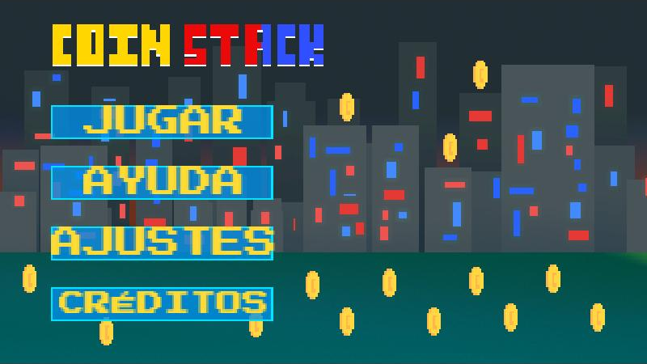
  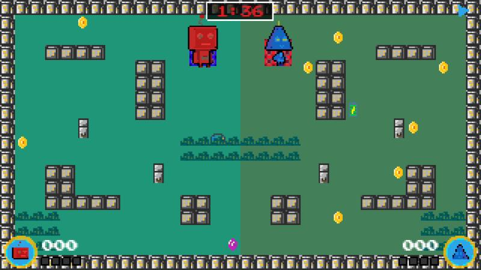
  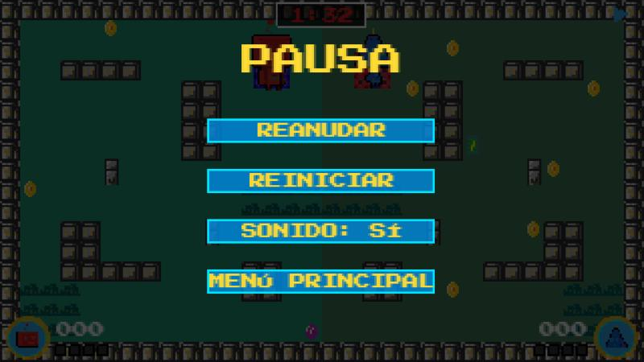
  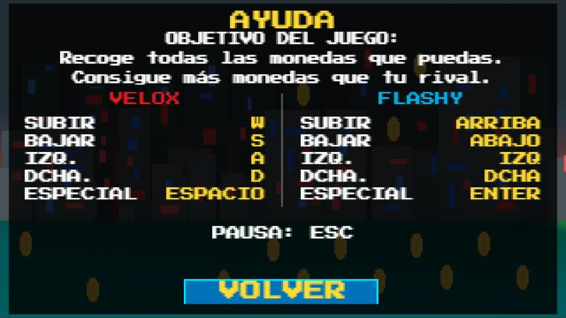
</p>

*Menú principal, partida en curso, menú de pausa y pantalla de ayuda.*

### Novedades de la Fase 2

- Juego completo: menú principal, ayuda, ajustes (volumen y cambio de teclas), créditos, partida, pausa y pantalla de fin de partida con revancha.
- Todas las mecánicas del GDD implementadas: monedas normales y especiales, fantasma, pilas con sobrecarga, altavoz y arbustos que ralentizan.
- HUD con temporizador, puntuación de cada jugador e indicador de pilas.
- Progresión de la partida por fases: cuanto menos tiempo queda, más monedas aparecen.
- Música distinta en el menú, en la partida y en la pantalla de resultados, y efectos de sonido.
- Transiciones con fundidos entre escenas y efectos de cámara (temblor al recibir daño o usar el altavoz).

Los cambios de diseño respecto a la Fase 1 se explican en el apartado [10](#10-cambios-respecto-a-la-fase-1).

---

# Game Design Document (GDD)

## Índice

1. [Introducción](#1-introducción)
2. [Especificaciones básicas](#2-especificaciones-básicas)
3. [Jugabilidad](#3-jugabilidad)
4. [Narrativa](#4-narrativa)
5. [Imagen y diseño visual](#5-imagen-y-diseño-visual)
6. [Sonido](#6-sonido)
7. [Interfaz y diagrama de flujo](#7-interfaz-y-diagrama-de-flujo)
8. [Comunicación y marketing](#8-comunicación-y-marketing)
9. [Referencias](#9-referencias)
10. [Cambios respecto a la Fase 1](#10-cambios-respecto-a-la-fase-1)
11. [Créditos](#11-créditos)

---

## 1. Introducción

### 1.1. Concepto del juego

Coin Stack es un juego de recolección competitiva para dos jugadores. Representado en 2D y con estilo pixel art, los jugadores deberán recolectar la mayor cantidad de monedas en un tiempo limitado a 2 minutos.

Entre las monedas que se encuentran en el escenario también habrá objetos que les otorgarán habilidades especiales a los jugadores.

### 1.2. Propuesta de valor

A pesar de que existen muchos juegos multijugador para PC, móvil y otros dispositivos, nosotros ofrecemos una experiencia rápida y entretenida donde los jugadores podrán competir para dejar ver sus habilidades y capacidad de explotar al máximo su estrategia.

Se puede subir la dificultad para competir contra usuarios de más rango y así no quedarse estancado en el mismo nivel de dificultad.

- **Característica diferencial 1:** juego con ritmo frenético.
- **Característica diferencial 2:** loop adictivo con variedad entre partidas.

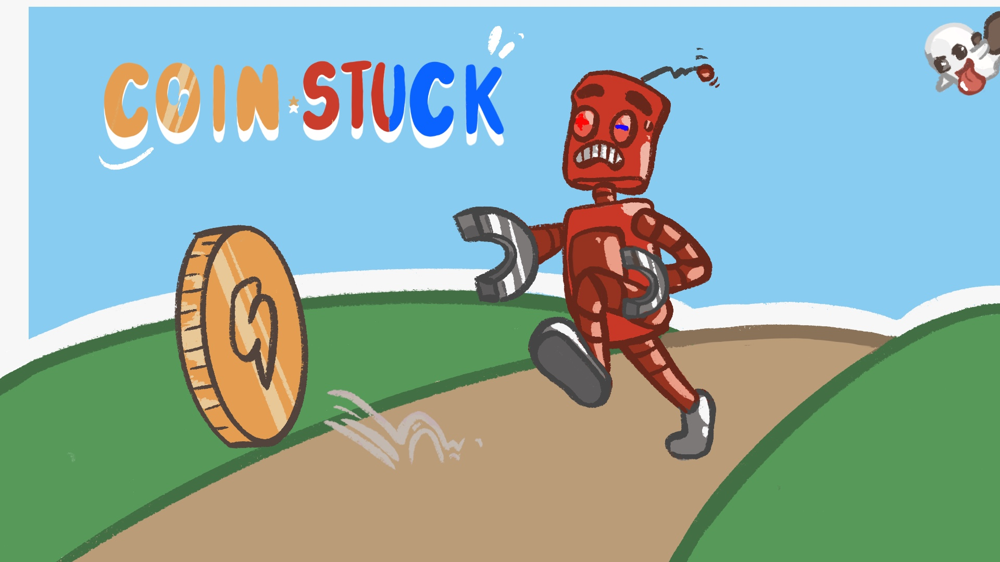

*Figura 1. Imagen promocional del juego.*

---

## 2. Especificaciones básicas

| **Título** | CoinStack Multiplayer |
| :--- | :--- |
| **Género** | Recolección competitiva, party game |
| **Número de jugadores** | 2 (en red, tiempo real) |
| **Público objetivo** | Jugadores casuales a partir de 7 años |
| **Clasificación PEGI** | PEGI 3, es un juego pensado para todas las edades, por lo tanto, no incluye violencia, lenguaje inapropiado ni contenido sensible |
| **Plataforma** | Navegador web (PC), desarrollado con Phaser 3 |
| **Duración de una partida** | 2 minutos |
| **Representación** | 2D |
| **Licencia** | Apache 2.0 |

---

## 3. Jugabilidad

### 3.1. Objetivo del juego

El objetivo de cada jugador es recolectar el mayor número de monedas posible para conseguir más puntos que el rival. La partida termina cuando se agota el tiempo establecido. Gana el jugador que más puntos tenga cuando acabe la partida.

### 3.2. Controles

| Acción | Jugador 1 | Jugador 2 |
| :--- | :---: | :---: |
| Moverse a la izquierda | `A` | `←` |
| Moverse a la derecha | `D` | `→` |
| Moverse arriba | `W` | `↑` |
| Moverse abajo | `S` | `↓` |
| Acción especial Sobrecarga | `Espacio` | `Enter` |
| Pausa | `Esc` o clic en el botón de pausa | `Esc` o clic en el botón de pausa |

Las teclas de movimiento y de sobrecarga se pueden cambiar en **Ajustes → Cambiar controles**. El ratón se usa para navegar por los menús y para el botón de pausa de la partida. El altavoz se activa automáticamente al recogerlo (ver [3.3.1](#331-mecánicas-principales)).

### 3.3. Mecánicas

#### 3.3.1. Mecánicas principales

- Al pasar por encima de un ítem se recolecta automáticamente.
- Las monedas básicas tienen un valor de 1 punto, mientras que las especiales tienen un valor de 3 puntos.
- Cada cierto tiempo aparece un fantasma que persigue lentamente al robot más cercano, atravesando las paredes. Si toca a un jugador, este pierde 6 puntos (la puntuación nunca baja de 0) y el fantasma desaparece.
- Cuando un jugador tiene cuatro pilas, puede activar el modo sobrecarga con su tecla de acción especial: durante 10 segundos gana el doble de puntos al recoger monedas. Con cuatro pilas no se pueden recoger más.
- Al recoger un altavoz se lanza automáticamente una onda expansiva desde la posición del jugador. Si el rival está dentro del alcance de la onda, queda aturdido (inmovilizado) 6 segundos; si está lejos, el altavoz se desperdicia.
- Los arbustos del escenario ralentizan a la mitad la velocidad de los robots que los atraviesan.
- Al terminar la partida el jugador con más puntos gana. Si ambos tienen los mismos puntos, hay empate.

#### 3.3.2. Objetos y power-ups

| Objeto | Efecto | Duración | Aparición |
| :--- | :--- | :--- | :--- |
| Moneda | +1 punto | Hasta el fin de la partida | Aleatoria; el ritmo aumenta según avanza la partida (ver 3.4) |
| Moneda especial | +3 puntos | Hasta el fin de la partida | Igual que la moneda (15 % de probabilidad al principio, 30 % al final) |
| Batería (pila) | Con 4, permite activar la sobrecarga | Al activarse, 10 s | Aleatoria cada 15 s (máximo 3 a la vez) |
| Altavoz | Onda que aturde al rival si está cerca | 6 s | Aleatoria cada 10 s (máximo 1 a la vez) |
| Fantasma | −6 puntos al tocarlo | Desaparece a los 8 s | Cada 15 s, lejos de los dos robots |

#### 3.3.3. Sistema de puntuación

- Monedas básicas: 1 punto (2 en sobrecarga).
- Monedas especiales: 3 puntos (6 en sobrecarga).
- Fantasma: -6 puntos. La puntuación nunca baja de 0.

### 3.4. Físicas y dificultad

- **Gravedad y salto:** inexistente (vista cenital).
- **Colisiones:** los robots chocan con las paredes y los obstáculos, pero no entre sí. Solo colisionan sus pies, de forma que la cabeza puede pasar por delante de una pared que está detrás (vista cenital con orden de profundidad). Los fantasmas atraviesan las paredes.
- **Rebotes / fricción / empujes:** onda expansiva del altavoz, que aturde al rival dentro de su alcance.
- **Plataformas móviles o superficies especiales (hielo, rebote...):** arbustos que ralentizan a la mitad al jugador que los cruza.
- **Progresión de la dificultad:** la partida se divide en tres fases. Al cambiar de fase se anuncia "¡MÁS MONEDAS!" en pantalla.

| Fase | Tiempo restante | Aparición de monedas | Máximo en el mapa | Probabilidad de especial |
| :--- | :--- | :--- | :--- | :--- |
| 1 | 2:00 – 1:01 | Cada 1 s | 10 | 15 % |
| 2 | 1:00 – 0:31 | Cada 0,7 s | 15 | 20 % |
| 3 | 0:30 – 0:00 | Cada 0,4 s | 20 | 30 % |

### 3.5. Escenario

El escenario representa un estadio. Se compone de 2 zonas:

1. **Zona Azul:** mitad de la cancha del jugador 1.
2. **Zona Roja:** mitad de la cancha del jugador 2.

En la versión jugable, el estadio es una cuadrícula de 32×18 casillas de 10×10 píxeles. El mapa es simétrico para que ningún jugador tenga ventaja: está rodeado por una barrera exterior y contiene bloques de barreras interiores, obstáculos, una franja de arbustos en el centro (la zona más disputada) y otras dos en las esquinas inferiores. Cada jugador empieza en su casilla de salida, en la parte superior central.

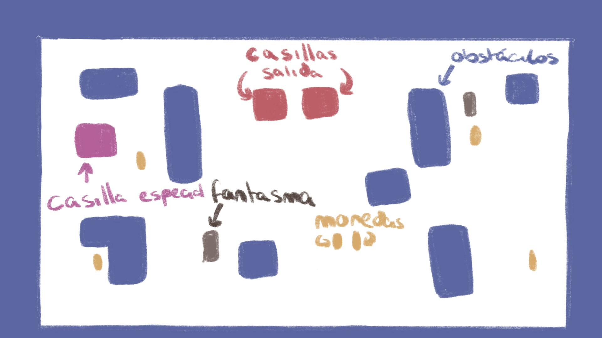

*Figura 2. Mapa del escenario con zonas de aparición y obstáculos.*

---

## 4. Narrativa

### 4.1. Historia

Nos encontramos en el futuro, el mundo sufre una gran crisis energética y las fuentes de energía tradicionales comienzan a gastarse. Los científicos del planeta descubren que existen unas monedas capaces de almacenar muchísima energía, pero estas aparecen durante poco tiempo y son difíciles de conseguir. Estas monedas sólo pueden ser recolectadas por robots. Por lo tanto, al existir dos ciudades que pelean entre ellas por conseguir el poder energético, se crea "Coin Stack", una competición en la que dos robots los cuales representan a sus respectivas ciudades, se enfrentan dentro de una arena cerrada para conseguir el mayor número de monedas posible.

Cada robot debe recorrer el escenario, esquivar los obstáculos y conseguir tantas monedas como pueda antes de que acabe el tiempo. Adicionalmente, hay monedas especiales que proporcionan más energía, pero también suponen un mayor riesgo.

Al terminar el tiempo, el robot que haya conseguido más energía será el ganador y su ciudad obtendrá el reconocimiento de ser la mejor recolectora y conseguirá el poder energético.

### 4.2. Personajes

#### VeloX (Jugador 1)

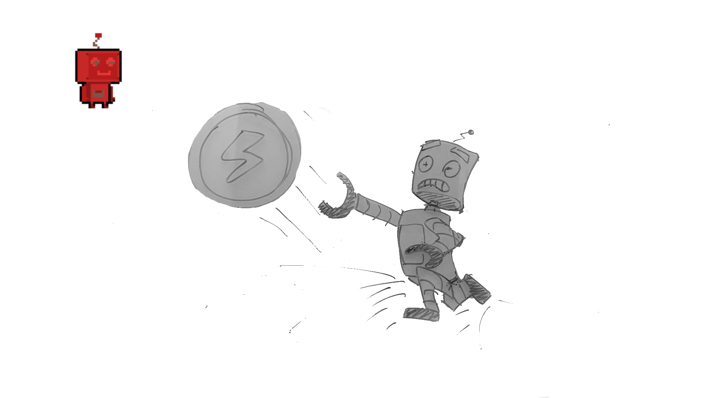

- **Edad / origen:** robot creado por la ciudad de Nova para competir en Coin Stack y recolectar monedas.
- **Personalidad:** competitivo y rápido.
- **Motivación:** conseguir monedas para proclamar a su ciudad campeona.
- **Trasfondo:** construido para poder competir y conseguir monedas.

#### FlashY (Jugador 2)

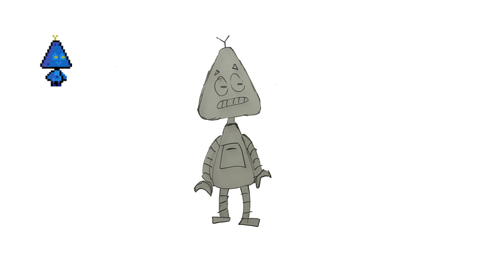

- **Edad / origen:** robot creado por la ciudad de Future para competir en Coin Stack y recolectar monedas.
- **Personalidad:** luchador y veloz.
- **Motivación:** conseguir monedas para proclamar a su ciudad campeona.
- **Trasfondo:** fue construido para poder competir y conseguir las monedas.

Ambos tienen las mismas habilidades, por lo que ninguno tiene una habilidad especial; ambos se caracterizan por la velocidad.

#### Fantasma (enemigo / personaje no jugable)

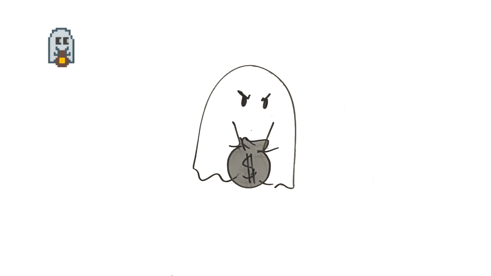

Cada 15 segundos aparece un fantasma lejos de los dos robots. Persigue lentamente al robot más cercano atravesando las paredes, resta 6 puntos al jugador que toca y desaparece a los 8 segundos si no alcanza a nadie.

---

## 5. Imagen y diseño visual

### 5.1. Logotipo


*Figura 3. Logotipo del juego. Concepto: una moneda con la cabeza del robot VeloX.*

### 5.2. Estilo visual

El juego utiliza un estilo pixel art en una pantalla de resolución total 320x180 píxeles porque permite crear escenarios y personajes lo suficientemente detallados sin perder el estilo pixel art. Todos los sprites están dibujados a su tamaño real y el juego se escala a la ventana sin suavizado, para que los píxeles se vean nítidos.

La tipografía de todo el juego es *Press Start 2P*, una fuente pixel art que encaja con el estilo visual.

### 5.3. Uso de colores

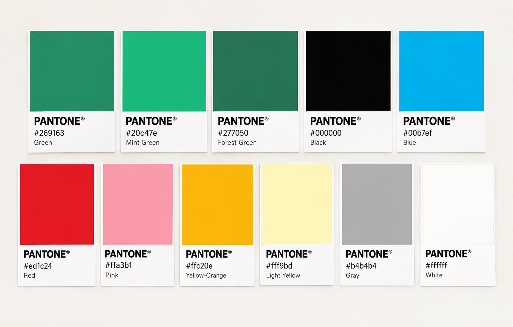

*Figura 4. Paleta de colores del juego.*

Paleta por colores:

- **Verde:** `269163` / `20c47e` / `277050`
- **Negro:** `000000`
- **Azul:** `00b7ef`
- **Rojo:** `ed1c24` / `ffa3b1`
- **Amarillo:** `ffc20e` / `fff9bd`
- **Gris:** `b4b4b4`
- **Blanco:** `ffffff`

### 5.4. Aspectos técnicos: cámara y representación

- **Representación:** 2D, vista cenital.
- **Cámara:** fija, mostrando todo el escenario. Se usan efectos de cámara: fundidos al entrar y salir de las escenas y temblor al tocar un fantasma o al usar el altavoz.
- **Resolución base:** 320x180 píxeles.

### 5.5. Inspiración artística y cultural

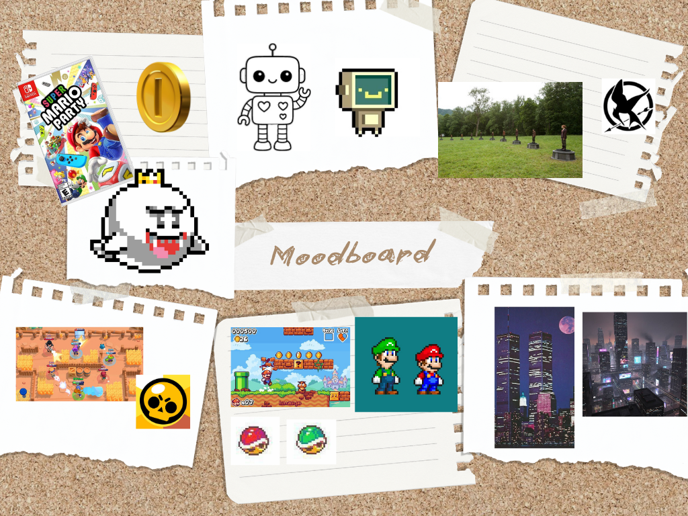

*Figura 5. Moodboard con las referencias visuales.*

- **Super Mario Party Jamboree** (videojuego, 2024): tomamos el tono "festivo" del juego.
- **Brawl Stars** (videojuego, 2017): tomamos el estilo de cámara y escenario.

### 5.6. Bocetos de personajes y pantallas

Los bocetos de los personajes se encuentran en el apartado [4.2](#42-personajes) y los de las pantallas en el apartado [7.1](#71-pantallas).

---

## 6. Sonido

### 6.1. Banda sonora

Finalmente no se ha compuesto música propia: se han usado pistas con licencia libre de OpenGameArt (autores y licencias en el apartado [11](#11-créditos)).

| Pista | Escena | Estilo / ambiente |
| :--- | :--- | :--- |
| Noisy Tubes | Menú principal, ayuda, ajustes y créditos | Electrónica enérgica |
| Cyber Core | Partida | Electrónica de ritmo rápido |
| Winning the Race | Fin de partida | Electrónica festiva |

La música del menú no se reinicia al moverse entre el menú, la ayuda, los ajustes y los créditos.

### 6.2. Efectos de sonido

| Efecto | Momento en que se reproduce |
| :--- | :--- |
| Recogida de moneda | Al recoger una moneda |
| Recogida de moneda especial | Al recoger una moneda especial |
| Pila | Al recoger una pila |
| Sobrecarga | Al activar la sobrecarga |
| Altavoz | Al lanzar la onda del altavoz |
| Fantasma | Al ser tocado por un fantasma |
| Click | Al pulsar cualquier botón |

El volumen general se ajusta en **Ajustes** y el sonido se puede silenciar desde el menú de pausa.

---

## 7. Interfaz y diagrama de flujo

### 7.1. Pantallas

**Menú principal**

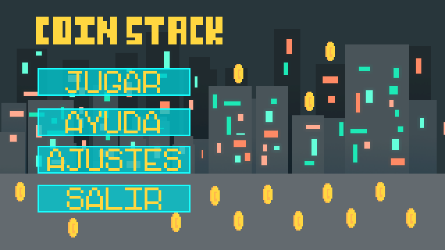

*Figura 6. Menú principal: boceto de menú principal.*

**Pantalla de juego (HUD)**

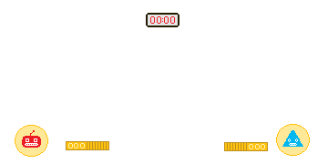

*Figura 7. Pantalla de juego: boceto de escenario.*

**Ajustes, ayuda y fin de partida**

<p align="center">
  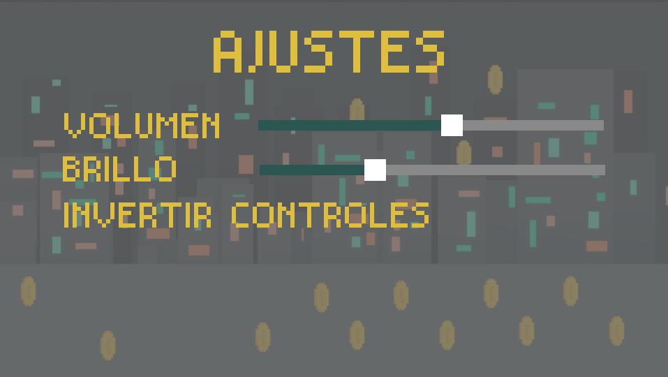
  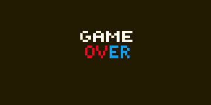
  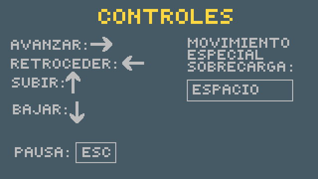
</p>

*Figura 8. Pantalla de ajustes (arriba a la izquierda), fin de partida (arriba a la derecha) y ayuda (abajo).*

### 7.2. Diagrama de flujo

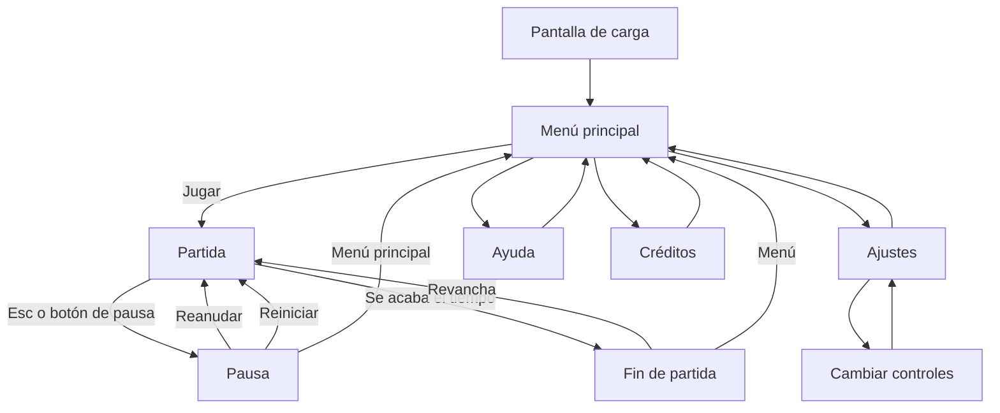

---

## 8. Comunicación y marketing

- **Público y mensaje clave:** para todos los públicos, para divertirse.
- **Canales:** redes sociales (Instagram, X y TikTok), itch.io y GitHub.
- **Calendario:** *teaser* en diciembre y lanzamiento en 2027.
- **Material:** tráiler, capturas, GIF de jugabilidad, *press kit*.
- **Eslogan:** «¡Cada moneda cuenta, cada segundo importa!».

---

## 9. Referencias

[1] Schell, J. (2019). *The Art of Game Design: A Book of Lenses* (3.ª ed.). CRC Press.

[2] Phaser Studio. (s. f.). *Phaser 3 Documentation*. https://docs.phaser.io

---

## 10. Cambios respecto a la Fase 1

Durante el desarrollo de la versión jugable se han tomado estas decisiones, que modifican lo planteado en la Fase 1:

- **Altavoz automático:** al jugar dos personas en el mismo ordenador comparten un único ratón, así que usar el altavoz con clic resultaba ambiguo. Ahora se activa al recogerlo y lanza una onda con un alcance visible; solo aturde al rival si está dentro de ella.
- **Sobrecarga manual:** al juntar 4 pilas la sobrecarga no se activa sola, sino que el jugador decide cuándo usarla con su tecla de acción especial.
- **Fantasma que persigue:** en lugar de ser un objeto quieto, persigue lentamente al robot más cercano y desaparece pasados 8 segundos.
- **Puntuación mínima de 0:** el fantasma no puede dejar a un jugador con puntos negativos.
- **Sin ajustes de partida:** el botón Jugar empieza la partida directamente.
- **Pausa:** además de reanudar y volver al menú, permite reiniciar la partida y silenciar el sonido. Los ajustes completos están disponibles desde el menú principal.
- **Música:** se ha sustituido la banda sonora propia prevista por pistas con licencia libre, y se ha eliminado la música de derrota y la del altavoz.

---

## 11. Créditos

### Equipo

- **Irene Mendoza Mederos:** diseño del icono y programación de los menús y ajustes.
- **José Manuel Gómez Ruiz:** programación de la lógica del juego.
- **Marina Perona García:** diseño de tiles, obstáculos y objetos.
- **Carla González Domínguez:** diseño de interfaces y personajes.

### Recursos externos

| Recurso | Uso en el juego | Autor | Licencia |
| :--- | :--- | :--- | :--- |
| [Noisy Tubes](https://opengameart.org/content/noisy-tubes) | Música del menú | HorrorPen | CC-BY |
| [Cyber Core](https://opengameart.org/content/cyber-core) | Música de la partida | [oglsdl](https://opengameart.org/users/oglsdl) | CC0 |
| [Winning the Race](https://opengameart.org/content/winning-the-race) | Música de fin de partida | section31 | CC0 |
| [Shooting Sounds 003](https://opengameart.org/content/collaboration-sound-effects-shooting-sounds-003) | Sonido del altavoz | Jesús Lastra | CC-BY 3.0 |
| [Electric Sound Effects Library](https://opengameart.org/content/electric-sound-effects-library) | Sonidos de monedas, moneda especial, pila y sobrecarga | Little Robot Sound Factory ([www.littlerobotsoundfactory.com](http://www.littlerobotsoundfactory.com)) | CC-BY 3.0 |
| Sonido del fantasma | Al tocar un fantasma | José Manuel Gómez Ruiz | Propio |
| Sonido de clic | Botones de los menús | Desconocido | Desconocida |
| [Press Start 2P](https://fonts.google.com/specimen/Press+Start+2P) | Tipografía | CodeMan38 | SIL Open Font License 1.1 |
| [Phaser 3](https://phaser.io) | Motor del juego | Phaser Studio | MIT |
