

  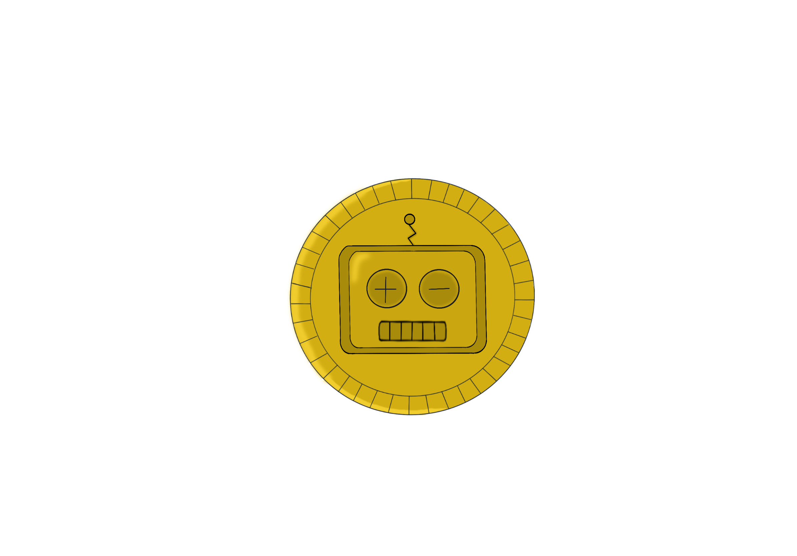

# Coin Stack

**Juegos en Red · Grado en Diseño y Desarrollo de Videojuegos · URJC · Curso 2026/27** 
**Grupo H**

## Descripción de la temática

Coin Stack es un juego recolector competitivo en 2D para dos jugadores en red en el que tendrán que enfrentarse a contrarreloj para recoger el máximo número de monedas en un tablero con obstáculos y trampas. Ambientado en una arena de combate 2D con zonas verdes, los jugadores deben agudizar sus habilidades y astucia para poder superar a su contrincante.

## Equipo de desarrollo

| Nombre y apellidos | Correo URJC | GitHub |
| :--- | :--- | :--- |
| Marina Perona García | m.perona.2024@alumnos.urjc.es | `@marinopepinillo` |
| Carla González Domínguez | c.gonzalezd.2024@alumnos.urjc.es | `@Macarroneh` |
| Irene Mendoza Mederos | i.mendoza.2024@alumnos.urjc.es | `@irenemendo114` |
| José Manuel Gómez Ruiz | jm.gomez.2024@alumnos.urjc.es | `@jmgomezzz` |

**Repositorio:** [https://github.com/jmgomezzz/CoinStack](https://github.com/jmgomezzz/CoinStack)

**Licencia:** [Apache 2.0](LICENSE)

---

# Game Design Document (GDD)

## Índice

1. [Introducción](#1-introducción)
2. [Especificaciones básicas](#2-especificaciones-básicas)
3. [Jugabilidad](#3-jugabilidad)
4. [Narrativa](#4-narrativa)
5. [Imagen y diseño visual](#5-imagen-y-diseño-visual)
6. [Sonido](#6-sonido)
7. [Interfaz y diagrama de flujo](#7-interfaz-y-diagrama-de-flujo)
8. [Comunicación y marketing](#8-comunicación-y-marketing)
9. [Referencias](#9-referencias)

---

## 1. Introducción

### 1.1. Concepto del juego

Coin Stack es un juego de recolección competitiva para dos jugadores. Representado en 2D y con estilo pixel art, los jugadores deberán recolectar la mayor cantidad de monedas en un tiempo limitado a 2 minutos.

Entre las monedas que se encuentran en el escenario también habrá objetos que les otorgarán habilidades especiales a los jugadores.

### 1.2. Propuesta de valor

A pesar de que existen muchos juegos multijugador para PC, móvil y otros dispositivos, nosotros ofrecemos una experiencia rápida y entretenida donde los jugadores podrán competir para dejar ver sus habilidades y capacidad de explotar al máximo su estrategia.

Se puede subir la dificultad para competir contra usuarios de más rango y así no quedarse estancado en el mismo nivel de dificultad.

- **Característica diferencial 1:** juego con ritmo frenético.
- **Característica diferencial 2:** loop adictivo con variedad entre partidas.

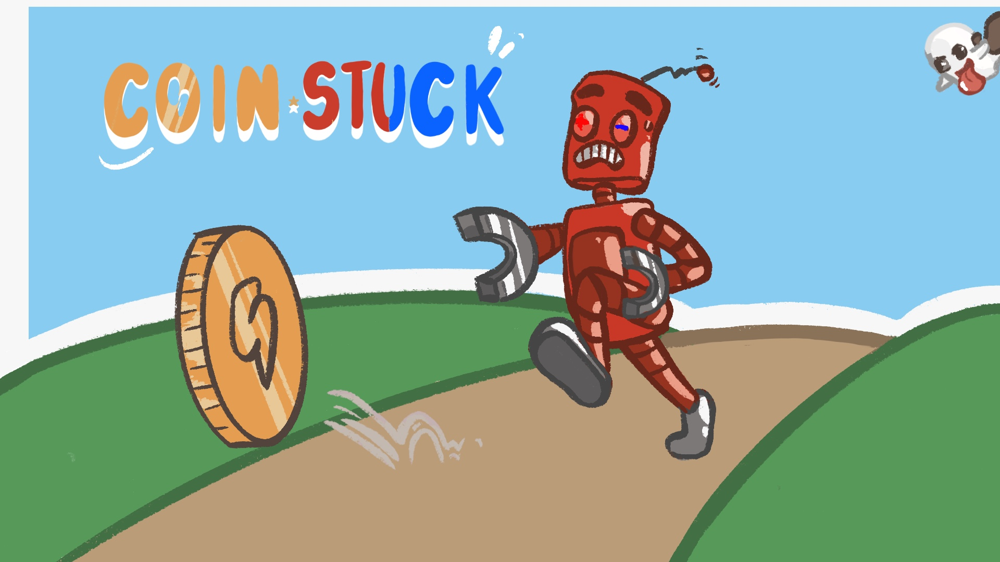

*Figura 1. Imagen promocional del juego.*

---

## 2. Especificaciones básicas

| **Título** | CoinStack Multiplayer |
| :--- | :--- |
| **Género** | Recolección competitiva, party game |
| **Número de jugadores** | 2 (en red, tiempo real) |
| **Público objetivo** | Jugadores casuales a partir de 7 años |
| **Clasificación PEGI** | PEGI 3, es un juego pensado para todas las edades, por lo tanto, no incluye violencia, lenguaje inapropiado ni contenido sensible |
| **Plataforma** | Navegador web (PC), desarrollado con Phaser 3 |
| **Duración de una partida** | 2 minutos |
| **Representación** | 2D |
| **Licencia** | Apache 2.0 |

---

## 3. Jugabilidad

### 3.1. Objetivo del juego

El objetivo de cada jugador es recolectar el mayor número de monedas posible para conseguir más puntos que el rival. La partida termina cuando se agota el tiempo establecido. Gana el jugador que más puntos tenga cuando acabe la partida.

### 3.2. Controles

| Acción | Jugador 1 | Jugador 2 |
| :--- | :---: | :---: |
| Moverse a la izquierda | `A` | `←` |
| Moverse a la derecha | `D` | `→` |
| Moverse arriba | `W` | `↑` |
| Moverse abajo | `S` | `↓` |
| Acción especial Sobrecarga | `Espacio` | `Enter` |
| Usar el altavoz | Ratón (clic izquierdo) | Ratón (clic izquierdo) |
| Pausa | `Esc` | `Esc` |

### 3.3. Mecánicas

#### 3.3.1. Mecánicas principales

- Al pasar por encima de un ítem se recolecta automáticamente.
- Las monedas básicas tienen un valor de 1 punto, mientras que las especiales tienen un valor de 3 puntos.
- Al recolectar un fantasma el jugador pierde 6 puntos.
- Al recoger un jugador cuatro pilas, se activa el modo sobrecarga, que otorga el doble de puntos al recoger monedas.
- Si un jugador recoge un altavoz y lo usa cerca de su oponente, lo inmovilizará 6 segundos.
- Al terminar la partida el jugador con más monedas gana.

#### 3.3.2. Objetos y power-ups

| Objeto | Efecto | Duración | Aparición |
| :--- | :--- | :--- | :--- |
| Moneda | +1 punto | Hasta el fin de la partida | Aleatoria cada segundo |
| Batería | Con 4 activas, sobrecarga | Al activarse, 10 s | Aleatoria cada 15 s |
| Altavoz | Aturde a un enemigo | 6 s | Aleatoria cada 10 s |

#### 3.3.3. Sistema de puntuación

- Monedas básicas: 1 punto.
- Monedas especiales: 3 puntos.
- Fantasma: -6 puntos.

### 3.4. Físicas y dificultad

- **Gravedad y salto:** inexistente (vista cenital).
- **Colisiones:** exclusivas con las paredes.
- **Rebotes / fricción / empujes:** interacción al usar el altavoz.
- **Plataformas móviles o superficies especiales (hielo, rebote...):** superficie especial de arbustos/espinas que ralentiza al jugador.
- **Progresión de la dificultad:** a medida que avanza la partida aparecen más monedas y objetos.

### 3.5. Escenario

El escenario representa un estadio. Se compone de 2 zonas:

1. **Zona Azul:** mitad de la cancha del jugador 1.
2. **Zona Roja:** mitad de la cancha del jugador 2.

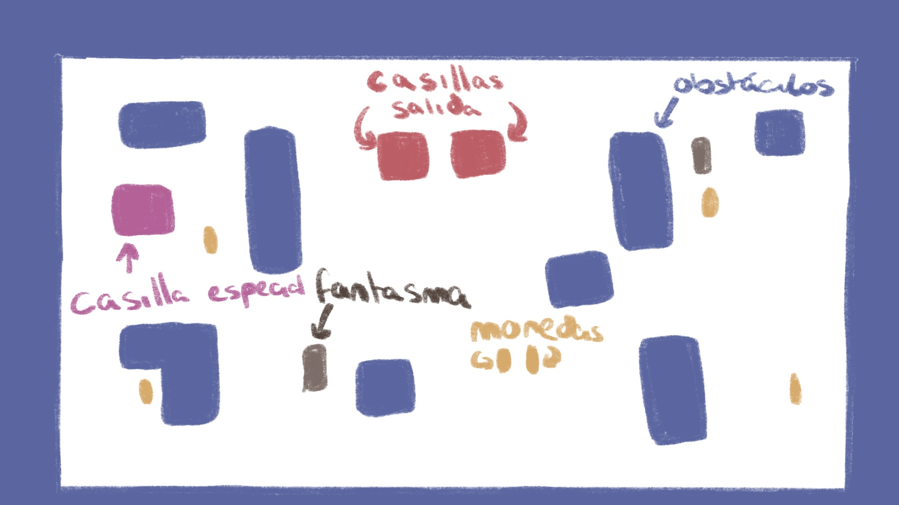

*Figura 2. Mapa del escenario con zonas de aparición y obstáculos.*

---

## 4. Narrativa

### 4.1. Historia

Nos encontramos en el futuro, el mundo sufre una gran crisis energética y las fuentes de energía tradicionales comienzan a gastarse. Los científicos del planeta descubren que existen unas monedas capaces de almacenar muchísima energía, pero estas aparecen durante poco tiempo y son difíciles de conseguir. Estas monedas sólo pueden ser recolectadas por robots. Por lo tanto, al existir dos ciudades que pelean entre ellas por conseguir el poder energético, se crea "Coin Stack", una competición en la que dos robots los cuales representan a sus respectivas ciudades, se enfrentan dentro de una arena cerrada para conseguir el mayor número de monedas posible.

Cada robot debe recorrer el escenario, esquivar los obstáculos y conseguir tantas monedas como pueda antes de que acabe el tiempo. Adicionalmente, hay monedas especiales que proporcionan más energía, pero también suponen un mayor riesgo.

Al terminar el tiempo, el robot que haya conseguido más energía será el ganador y su ciudad obtendrá el reconocimiento de ser la mejor recolectora y conseguirá el poder energético.

### 4.2. Personajes

#### VeloX (Jugador 1)

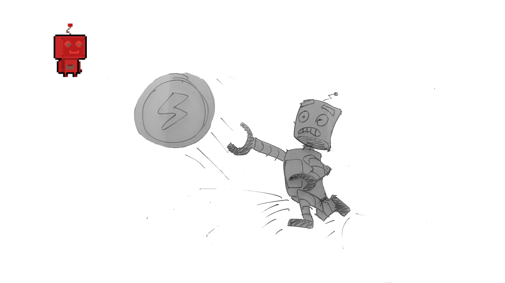

- **Edad / origen:** robot creado por la ciudad de Nova para competir en Coin Stack y recolectar monedas.
- **Personalidad:** competitivo y rápido.
- **Motivación:** conseguir monedas para proclamar a su ciudad campeona.
- **Trasfondo:** construido para poder competir y conseguir monedas.

#### FlashY (Jugador 2)

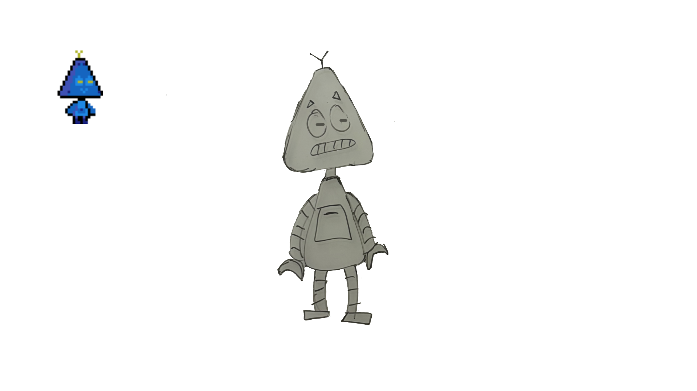

- **Edad / origen:** robot creado por la ciudad de Future para competir en Coin Stack y recolectar monedas.
- **Personalidad:** luchador y veloz.
- **Motivación:** conseguir monedas para proclamar a su ciudad campeona.
- **Trasfondo:** fue construido para poder competir y conseguir las monedas.

Ambos tienen las mismas habilidades, por lo que ninguno tiene una habilidad especial; ambos se caracterizan por la velocidad.

#### Fantasma (enemigo / personaje no jugable)

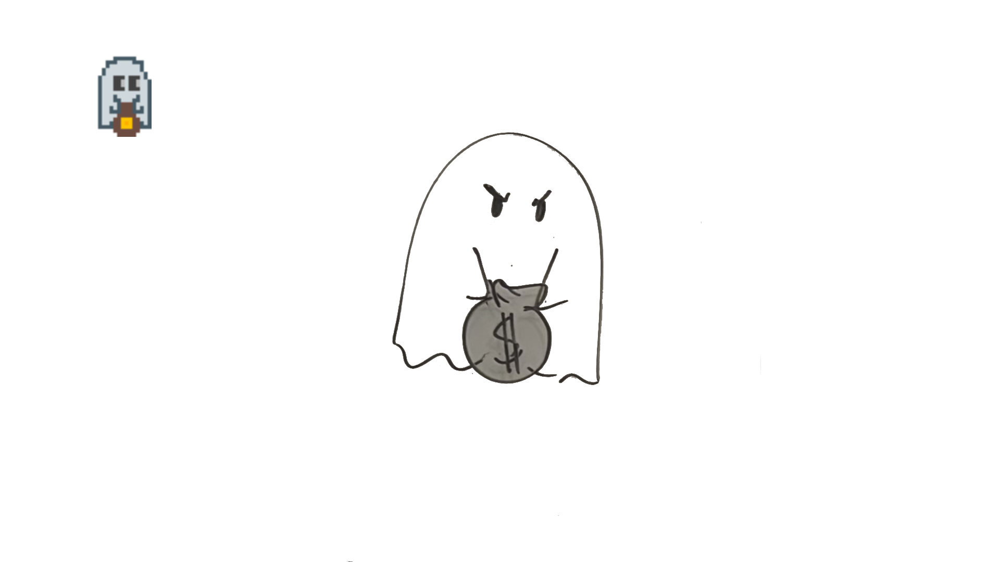

Aparece un fantasma en determinados momentos de la partida y resta 6 puntos al jugador que lo toca.

---

## 5. Imagen y diseño visual

### 5.1. Logotipo

*Figura 3. Logotipo del juego. Concepto: una moneda con la cabeza del robot VeloX.*

### 5.2. Estilo visual

El juego utiliza un estilo pixel art en una pantalla de resolución total 320x180 píxeles porque permite crear escenarios y personajes lo suficientemente detallados sin perder el estilo pixel art.

### 5.3. Uso de colores

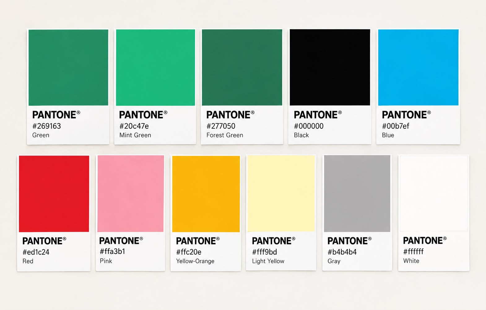

*Figura 4. Paleta de colores del juego.*

Paleta por colores:

- **Verde:** `269163` / `20c47e` / `277050`
- **Negro:** `000000`
- **Azul:** `00b7ef`
- **Rojo:** `ed1c24` / `ffa3b1`
- **Amarillo:** `ffc20e` / `fff9bd`
- **Gris:** `b4b4b4`
- **Blanco:** `ffffff`

### 5.4. Aspectos técnicos: cámara y representación

- **Representación:** 2D, vista cenital.
- **Cámara:** fija, mostrando todo el escenario.
- **Resolución base:** 320x180 píxeles.

### 5.5. Inspiración artística y cultural

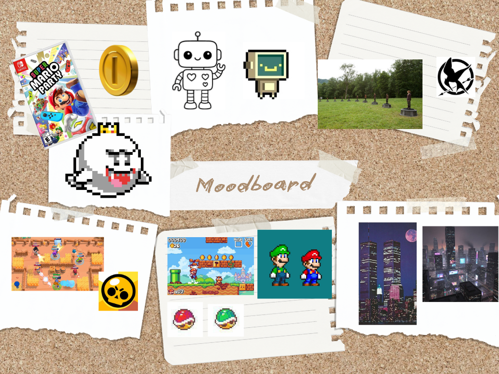

*Figura 5. Moodboard con las referencias visuales.*

- **Super Mario Party Jamboree** (videojuego, 2024): tomamos el tono "festivo" del juego.
- **Brawl Stars** (videojuego, 2017): tomamos el estilo de cámara y escenario.

### 5.6. Bocetos de personajes y pantallas

Los bocetos de los personajes se encuentran en el apartado [4.2](#42-personajes) y los de las pantallas en el apartado [7.1](#71-pantallas).

---

## 6. Sonido

### 6.1. Banda sonora

| Pista | Escena | Estilo / ambiente | Fuente / licencia |
| :--- | :--- | :--- | :--- |
| CoinMash! | Menú principal | Música 16 bits enérgica | Propia |
| The War of Coins | Partida | Música de ritmo rápido | Propia |
| I win! | Victoria | Fanfarria victoriosa | Propia |
| You'll get'em next time | Derrota | Piano triste | Propia |
| Torremolinos Type Beat | Activación del altavoz | Base de trap | Propia |

### 6.2. Efectos de sonido

| Efecto | Momento en que se reproduce |
| :--- | :--- |
| Recogida de moneda | Al recoger una moneda |
| Recogida de moneda especial | Al recoger una moneda especial |
| Bono incompleto | Al recoger las 3 primeras pilas |
| Bono | Al recoger la última pila |
| Click | Al hacer click en menús |
| Pausa | Al pausar |

---

## 7. Interfaz y diagrama de flujo

### 7.1. Pantallas

**Menú principal**

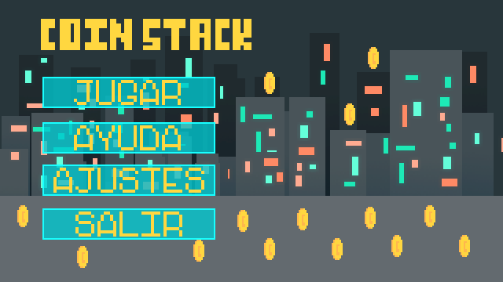

*Figura 6. Menú principal: boceto de menú principal.*

**Pantalla de juego (HUD)**

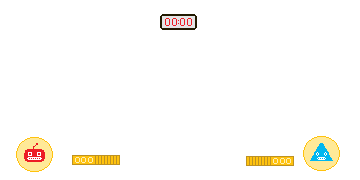

*Figura 7. Pantalla de juego: boceto de escenario.*

**Ajustes, ayuda y fin de partida**

  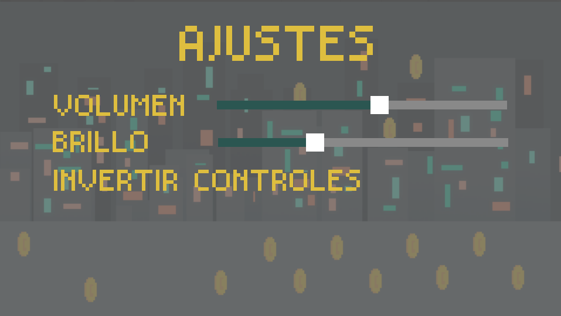
  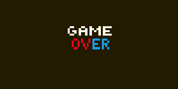
  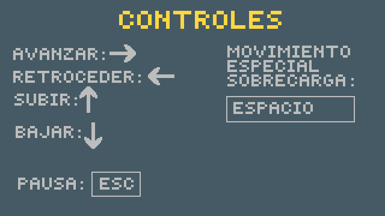

*Figura 8. Pantalla de ajustes (arriba a la izquierda), fin de partida (arriba a la derecha) y ayuda (abajo).*

### 7.2. Diagrama de flujo

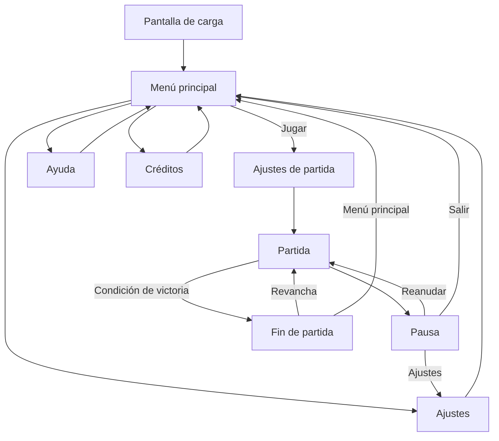

---

## 8. Comunicación y marketing

- **Público y mensaje clave:** para todos los públicos, para divertirse.
- **Canales:** redes sociales (Instagram, X y TikTok), itch.io y GitHub.
- **Calendario:** *teaser* en diciembre y lanzamiento en 2027.
- **Material:** tráiler, capturas, GIF de jugabilidad, *press kit*.
- **Eslogan:** «¡Cada moneda cuenta, cada segundo importa!».

---

## 9. Referencias

[1] Schell, J. (2019). *The Art of Game Design: A Book of Lenses* (3.ª ed.). CRC Press.

[2] Phaser Studio. (s. f.). *Phaser 3 Documentation*. https://docs.phaser.io
